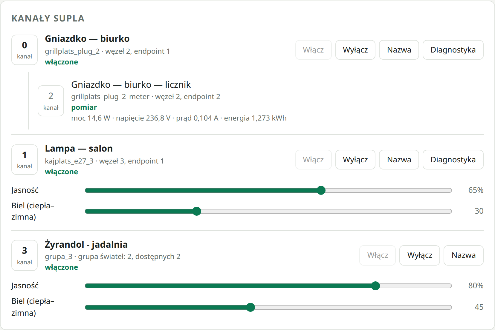

# matter2supla-linux-device

Most **Matter over Thread → SUPLA** na Linuksie. Urządzenia Matter (na początek gniazdko IKEA GRILLPLATS) są widoczne w SUPLA Cloud jako kanały jednego wirtualnego urządzenia SUPLA „Matter2Supla”, ze sterowaniem w obie strony.

```text
GRILLPLATS / KAJPLATS / czujniki
   │ Matter over Thread (802.15.4)
ESP32-C5 (firmware ot_rcp) ──USB── host Linux (Raspberry Pi)
                                    ├─ otbr           OpenThread Border Router
                                    ├─ matter-server  kontroler Matter (matterjs-server, WebSocket)
                                    ├─ bridge         łącznik Matter ⇄ MQTT + panel WWW (ten projekt)
                                    ├─ mqtt           Mosquitto
                                    └─ supla          supla-device dla Linuksa ⇄ SUPLA Cloud
```

Wszystkie usługi działają w kontenerach (`docker compose`) w sieci hosta — Matter wymaga IPv6, multicastu i mDNS. Własnym kodem jest tylko `bridge/` (Python) i konfiguracja. ESP32-C5 dostaje **niezmieniony** przykład `ot_rcp` z ESP-IDF — w repozytorium nie ma firmware dla ESP.

## Wymagania

- **Host:** Raspberry Pi z 64-bitowym systemem i wbudowanym Bluetooth (uruchomione na RPi 4B, Raspberry Pi OS / Debian 13 arm64), podłączony do LAN. Inny prawdziwy Linux też się nadaje; wariant z maszyną wirtualną na Proxmox opisuje [docs/proxmox-vm.md](docs/proxmox-vm.md). **Nie WSL2** (NAT psuje mDNS i IPv6).
- **Radio Thread:** płytka ESP32-C5 z firmware `ot_rcp`, podłączona portem **UART** (mostek USB-UART) przez przedłużacz do portu USB 2.0.
- **Bluetooth w hoście** — potrzebny do parowania urządzeń bezpośrednio do własnej sieci Thread.
- Docker z wtyczką Compose i buildx.
- Konto SUPLA z włączonym dodawaniem urządzeń (cloud.supla.org → „Moja SUPLA” → rejestracja urządzeń).

## Szybki start

Skrót dla Raspberry Pi; wersja krok po kroku, z wyjaśnieniami: [docs/instalacja-raspberry-pi.md](docs/instalacja-raspberry-pi.md).

1. **Dongle.** Zbuduj i wgraj `ot_rcp` na ESP32-C5 — [docs/dongle-esp32-c5.md](docs/dongle-esp32-c5.md). Uwaga: wgranie kasuje dotychczasowy firmware płytki.

   ```bash
   ./host/build-rcp-docker.sh rcp-build      # wypisuje polecenia esptool do wgrania
   ```

2. **Instalacja.** Podłącz dongle do Raspberry Pi i w katalogu projektu uruchom jedno polecenie:

   ```bash
   sudo ./host/install.sh --lan              # bez --lan panel działa tylko lokalnie (127.0.0.1)
   ```

   Skrypt instaluje Dockera (jeśli go nie ma), ustawia system, rozpoznaje dongle, tworzy `.env` i katalogi, tworzy sieć Thread, uruchamia usługi, przekazuje dane sieci kontrolerowi Matter i włącza codzienną kopię zapasową. Można go uruchamiać ponownie — niczego istniejącego nie nadpisuje i nie tworzy sieci Thread od nowa. Na końcu wypisuje adres panelu.

   Obrazy `bridge` i `supla-device` są pobierane z GHCR, jeśli są tam opublikowane; w przeciwnym razie skrypt buduje je na miejscu (na Raspberry Pi trwa to kilkanaście minut).

3. **Panel WWW** — wpisz konto SUPLA i sparuj urządzenie kodem lub zdjęciem kodu QR: [docs/panel-www.md](docs/panel-www.md), [docs/parowanie.md](docs/parowanie.md).

   

4. **Kopia zapasowa** powstaje codziennie o 03:30; pobierz jedną od razu po pierwszym parowaniu i trzymaj poza urządzeniem: [docs/kopie-zapasowe.md](docs/kopie-zapasowe.md).

Skrypt był uruchomiony na działającej instalacji (Raspberry Pi 4B): niczego nie zmienił w konfiguracji, tożsamości urządzenia ani sieci Thread, a usługi wróciły do pracy. **Pełna instalacja nim na czystym systemie nie była jeszcze sprawdzona** — gdyby zawiódł, te same kroki są opisane ręcznie w instrukcji.

## Najważniejsze ostrzeżenia

- **Kanały SUPLA są trwałe.** Wolno je tylko dopisywać; usunięcie kanału lub zmiana typu kończy się „Channel conflict” i usunięciem urządzenia z SUPLA Cloud razem z historią. Szczegóły: [docs/jak-to-dziala.md](docs/jak-to-dziala.md).
- **Sekrety poza repozytorium:** `.env`, `data/`, `backups/`, `config/devices.yaml`, `config/supla/` są w `.gitignore`. Dataset Thread, dane kontrolera Matter, GUID/AUTHKEY SUPLA i kody parowania `MT:…` nie mogą trafić do repozytorium. Kopie zapasowe zawierają to wszystko.
- **Panel nie szyfruje połączenia** (HTTP). Udostępniaj go tylko w zaufanej sieci LAN i nigdy do Internetu; to samo dotyczy REST OTBR, WebSocket `matter-server` i brokera MQTT (domyślnie nasłuchują tylko na `127.0.0.1`).

## Stan projektu

Co obsługuje łącznik:

| Funkcja | Stan |
| --- | --- |
| Gniazdko / przekaźnik (klaster OnOff): stan, sterowanie, dostępność | działa na sprzęcie (GRILLPLATS) |
| Panel WWW: konto SUPLA, parowanie kodem i zdjęciem QR, kanały, diagnostyka, kopie | działa na sprzęcie |
| Światła z regulacją bieli (KAJPLATS) jako kanał SUPLA „ściemniacz CCT”: jasność i temperatura bieli | działa na sprzęcie: polecenie z SUPLA Cloud dotarło do żarówki, stan wraca; wymaga protokołu SUPLA 28 na serwerze. Sterowanie także suwakami w panelu |
| Licznik energii gniazdka (napięcie, prąd, moc, energia) — kanał jednofazowy | działa na sprzęcie (GRILLPLATS): pomiary widoczne w aplikacji SUPLA; przy braku danych kanał przechodzi w offline (sprawdzone lokalnie) |
| Czujniki, inne typy urządzeń | nieobsługiwane — można sparować i pobrać zrzut diagnostyczny |

### Sprawdzone bez sprzętu (2026-11-25, maszyna deweloperska)

- 78 testów jednostkowych łącznika oraz test całości z prawdziwym brokerem Mosquitto.
- W zbudowanym obrazie `bridge`: odczyt kodu `MT:…` z wygenerowanego zdjęcia kodu QR oraz zapis konta SUPLA z panelu (przez API).
- Stos bez OTBR (`mqtt`, `matter-server` 1.6.1, `bridge`, `supla`) z węzłami testowymi zaimportowanymi do kontrolera: gniazdko pojawiło się samo jako kanał 0, a `supla-device` wystartował z wygenerowaną konfiguracją; czujnik i ściemniana żarówka trafiły na listę „bez kanału” z diagnostyką do pobrania; komenda i zmiana nazwy z panelu zadziałały, zmiana konfiguracji zrestartowała `supla-device`; żądanie z obcej strony zostało odrzucone.
- `supla-device` z wygenerowaną konfiguracją: kanał reaguje na `{"state": 1}` / `{"state": 0}`, przechodzi w offline po `{"state": -1}` oraz po 120 s bez wiadomości.

### Sprawdzone na Raspberry Pi 4B (2026-11-26, Raspberry Pi OS / Debian 13 arm64)

- Obrazy `bridge` i `supla-device` budują się na arm64, cały stos działa, border router z donglem ESP32-C5 (mostek CH340, 460800 bodów) jest liderem sieci Thread, kontroler ma włączony Bluetooth.
- GRILLPLATS sparowany kodem QR przez Bluetooth RPi do sieci Thread dongla; kanał 0 powstał sam; `supla-device` zarejestrował się w SUPLA Cloud; włącz/wyłącz z panelu przełącza gniazdko, a stan wraca z urządzenia i trafia do `supla-device` w ułamku sekundy.
- Naciśnięcie przycisku na gniazdku zmienia stan w aplikacji SUPLA (potwierdzone przez użytkownika).
- Żarówka KAJPLATS E27 WS sparowana zdjęciem kodu QR z telefonu przez panel (bez kanału SUPLA — patrz tabela wyżej).
- Parowanie przez Bluetooth RPi 4 bywa zawodne (połączenie udaje się w części prób) — nieudane parowanie wystarczy ponowić.
- Restart `supla-device` przy włączonym gniazdku nie wyłącza go.
- Odłączenie gniazdka na krótko i ponowne włożenie: gniazdko wraca do sieci Thread samo, kontroler odnawia sesję po ok. 1–2 minutach; w tym czasie komendy kończą się błędem.
- Restart Raspberry Pi: po ok. minucie wszystkie usługi działają, border router jest liderem tej samej sieci Thread, gniazdko jest dostępne bez ponownego parowania, `supla-device` ponownie rejestruje się w SUPLA Cloud.
- Kopie zapasowe: tworzenie, harmonogram, pobieranie z panelu i rozpakowanie z porównaniem zawartości.

### Sprawdzone na VM Ubuntu 26.04 na Proxmox (2026-11-25, wariant porzucony)

- Dongle po USB passthrough widoczny jako `/dev/ttyUSB0`; OTBR tworzy sieć Thread (stan `leader`); restart VM — stos i sieć wracają same; panel z LAN z logowaniem formularzem.
- Bluetooth przez passthrough adaptera hosta: kontroler zgłaszał włączony Bluetooth, ale **parowanie się nie udało** — ten adapter nie odbierał żadnych pakietów. Szczegóły: [docs/proxmox-vm.md](docs/proxmox-vm.md).

### Niesprawdzone

- Sterowanie gniazdkiem z aplikacji SUPLA (potwierdzona jest zmiana stanu w aplikacji po naciśnięciu przycisku oraz sterowanie z panelu).
- Odłączenie gniazdka na ponad 2 minuty → kanał offline w SUPLA.
- Czy SUPLA Cloud przyjmuje kanał dopisany do już zarejestrowanego urządzenia bez dodatkowych kroków (być może trzeba na chwilę włączyć rejestrację urządzeń).
- Pełne odtworzenie kopii zapasowej na drugim urządzeniu.
- Skrypt `host/flash-rcp.sh` (droga z zainstalowanym ESP-IDF) oraz wgrywanie firmware z Linuksa — wgrywano z Windows.
- Parowanie przez udostępnienie z innej aplikacji (bez Bluetootha).
- Inne modele Raspberry Pi i inne dystrybucje niż wymienione wyżej.

## Dokumentacja

Spis treści: [docs/README.md](docs/README.md).

| Dokument | Zawartość |
| --- | --- |
| [docs/dongle-esp32-c5.md](docs/dongle-esp32-c5.md) | sprzęt, budowa i wgranie firmware `ot_rcp` |
| [docs/instalacja-raspberry-pi.md](docs/instalacja-raspberry-pi.md) | instalacja krok po kroku: system, Docker, sysctl, udev, `.env`, sieć Thread, Bluetooth, start |
| [docs/proxmox-vm.md](docs/proxmox-vm.md) | wariant z maszyną wirtualną na Proxmox i jego ograniczenia |
| [docs/panel-www.md](docs/panel-www.md) | panel: dostęp i hasło, konto SUPLA, kanały, diagnostyka urządzeń nieobsługiwanych |
| [docs/parowanie.md](docs/parowanie.md) | parowanie urządzeń: tryb parowania, reset, ponawianie |
| [docs/kopie-zapasowe.md](docs/kopie-zapasowe.md) | kopie zapasowe i odtwarzanie na innym urządzeniu |
| [docs/rozwiazywanie-problemow.md](docs/rozwiazywanie-problemow.md) | znane problemy i ich rozwiązania |
| [docs/jak-to-dziala.md](docs/jak-to-dziala.md) | tematy MQTT, dostępność, trwałość kanałów SUPLA, pliki i porty |
| [docs/cli.md](docs/cli.md) | polecenia `m2s-bridge` |
| [docs/rozwoj.md](docs/rozwoj.md) | testy i dopisywanie obsługi nowych urządzeń |

## Komponenty zewnętrzne

- [openthread/ot-br-posix](https://github.com/openthread/ot-br-posix) — obraz `openthread/border-router`
- [matter-js/matterjs-server](https://github.com/matter-js/matterjs-server) — następca `python-matter-server` (ten zakończono na wersji 8.1.2), to samo API WebSocket
- [SUPLA/supla-device](https://github.com/SUPLA/supla-device) — `extras/examples/linux`
- ESP-IDF, przykład `examples/openthread/ot_rcp`

## Licencja

Copyright © 2026 Zjawa.IT - Jarosław Zjawiński, <kontakt@zjawa.it>.

Projekt jest wolnym oprogramowaniem na licencji **GNU General Public License w wersji 2 lub (do wyboru) dowolnej późniejszej** (`GPL-2.0-or-later`) — pełny tekst w pliku [LICENSE](LICENSE). W skrócie: wolno używać, kopiować, zmieniać i rozpowszechniać, pod warunkiem zachowania informacji o autorze i licencji oraz udostępniania zmienionych wersji na tej samej licencji, razem z kodem źródłowym. Oprogramowanie jest dostarczane bez jakiejkolwiek gwarancji.

Obraz `matter2supla-supla-device` zawiera [supla-device](https://github.com/SUPLA/supla-device) (AC SOFTWARE SP. Z O.O., `GPL-2.0-or-later`) zbudowany z commita przypiętego w `supla-device/Dockerfile`, z rozszerzeniami z katalogu `supla-device/extensions/`. Pozostałe komponenty (OTBR, matterjs-server, Mosquitto) są używane jako osobne, niezmienione obrazy na własnych licencjach.
