# Dokumentacja

Przegląd projektu, wymagania i stan prac: [../README.md](../README.md).

## Wdrożenie - w tej kolejności

1. [Dongle ESP32-C5](dongle-esp32-c5.md) - sprzęt, wgranie firmware `ot_rcp` z przeglądarki (<https://matter2supla.zjawa.tech>) albo budowa w Dockerze i wgranie przez esptool.
2. [Instalacja na Raspberry Pi](instalacja-raspberry-pi.md) - system, Docker, sysctl, udev, `.env`, sieć Thread, Bluetooth, start stosu.
   - Zamiast RPi: [maszyna wirtualna na Proxmox](proxmox-vm.md) - różnice i znane ograniczenia.
3. [Panel WWW](panel-www.md) - dostęp i hasło, konto SUPLA, kanały, diagnostyka.
4. [Parowanie urządzeń](parowanie.md) - tryb parowania, kod i zdjęcie QR, ponawianie.
5. [Kopie zapasowe i odtwarzanie](kopie-zapasowe.md) - harmonogram, zawartość kopii, przeniesienie na inne urządzenie.

## Eksploatacja

- [Aktualizacja](aktualizacja.md) - wersje i tagi obrazów, powiadomienie w panelu, ręczna aktualizacja `host/update.sh`, cofanie.
- [Rozwiązywanie problemów](rozwiazywanie-problemow.md) - objawy i rozwiązania z rzeczywistych uruchomień.
- [Jak urządzenia wyglądają w SUPLA](widok-w-supla.md) - zrzuty z SUPLA Cloud i aplikacji mobilnej.
- [Jak to działa](jak-to-dziala.md) - tematy MQTT, dostępność i offline, trwałość kanałów SUPLA, pliki, porty.
- [Polecenia CLI łącznika](cli.md) - `m2s-bridge` i jego opcje.

## Dla rozwijających projekt

- [Rozwój i testy](rozwoj.md) - testy, zrzuty diagnostyczne jako węzły testowe, budowa obrazów.

## Zrzuty ekranu panelu

Zrzuty panelu wykonane na przykładowych danych skryptem [`img/make_screenshots.py`](img/make_screenshots.py); opis sekcji w [panel-www.md](panel-www.md).

### Cały panel (komputer)

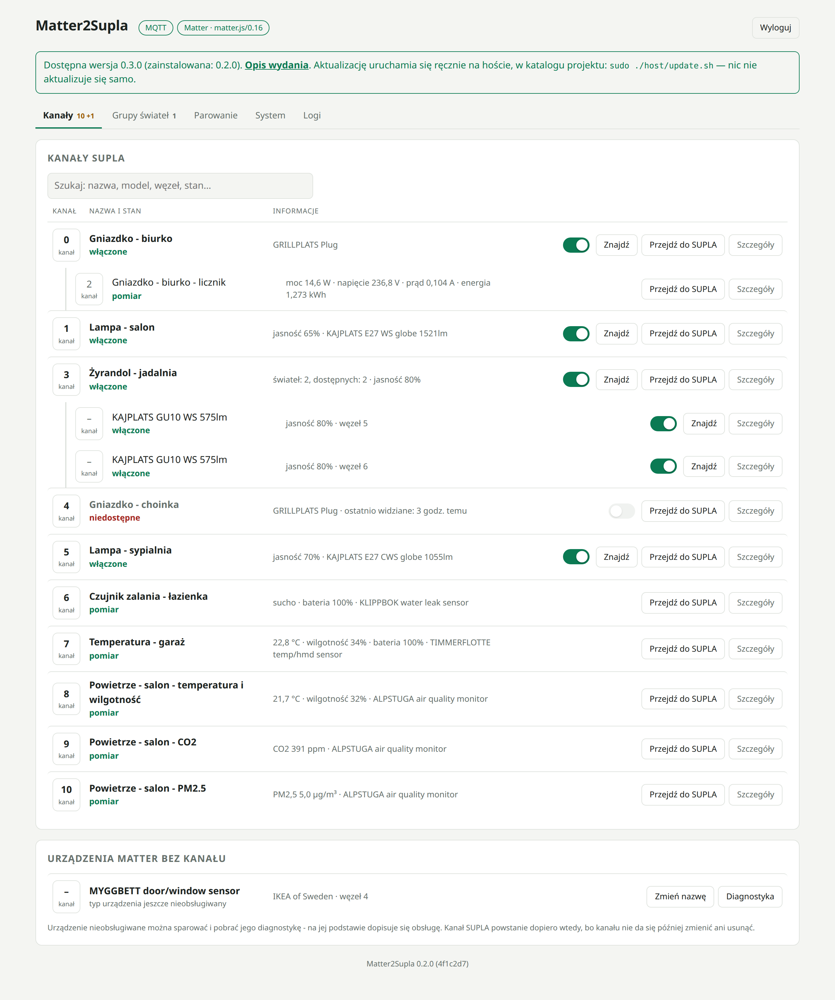

### Panel na telefonie (zakładka „Parowanie”)

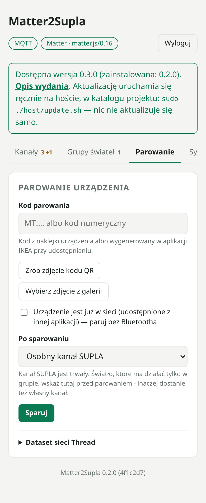

### Logowanie

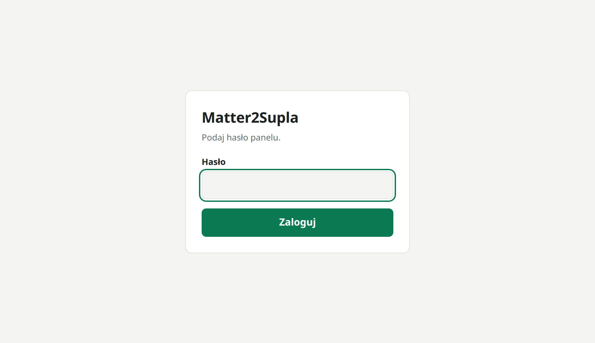

### Kanały SUPLA (z żarówką kolorową i selektorem koloru, czujnikami)

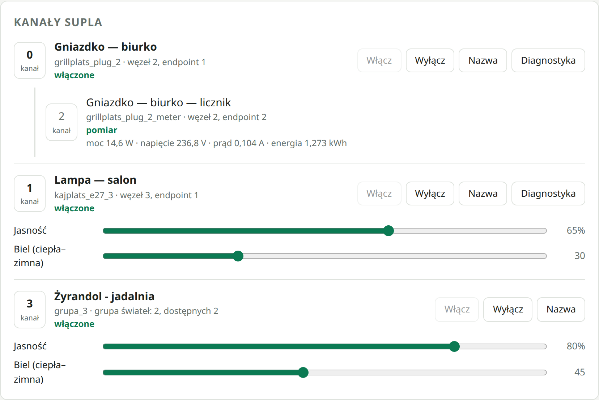

### Grupy świateł

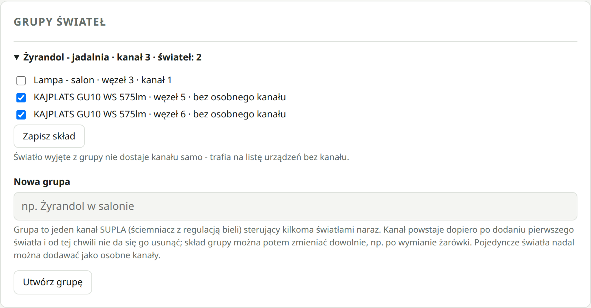

### Logi

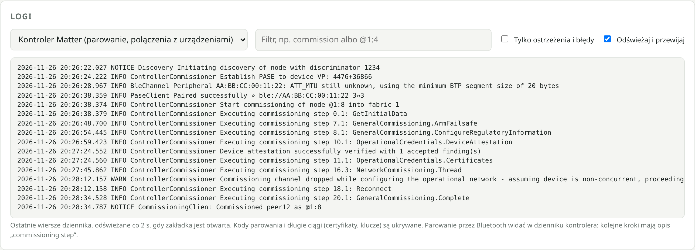

### Urządzenia Matter bez kanału

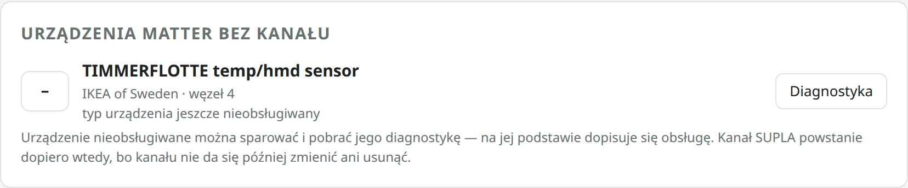

### Konto SUPLA

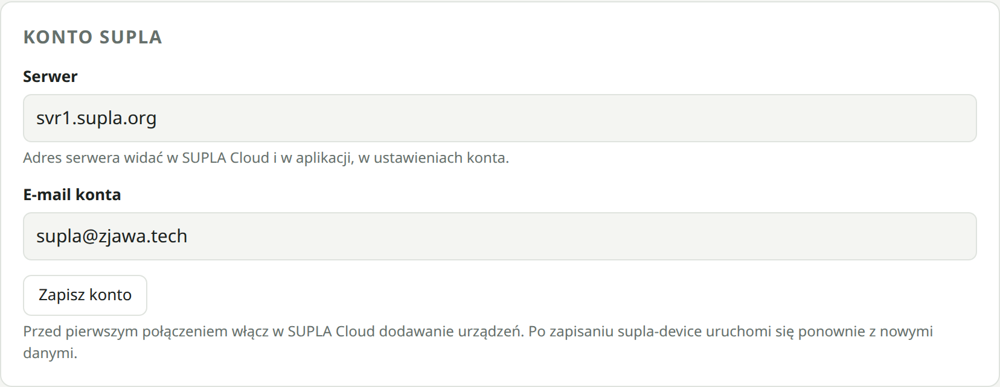

### Parowanie urządzenia

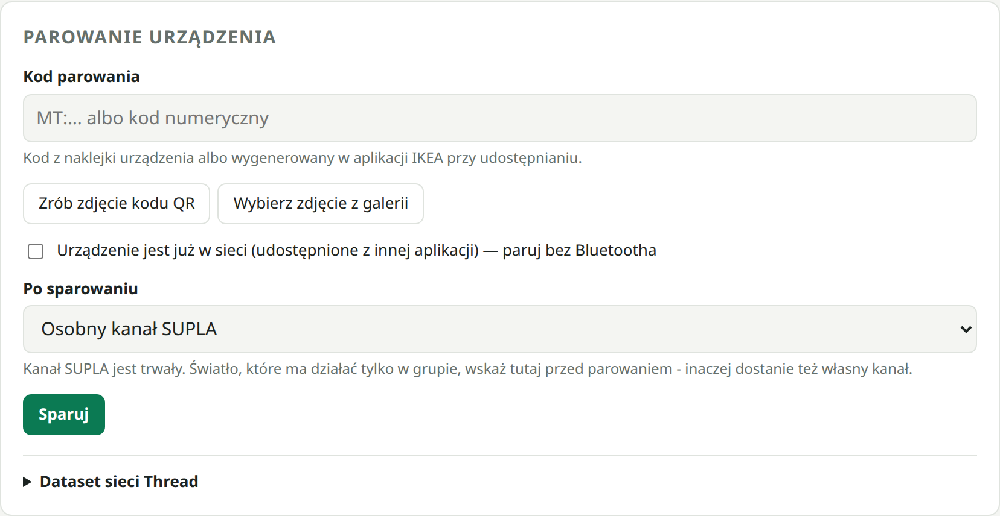

### Parowanie w toku

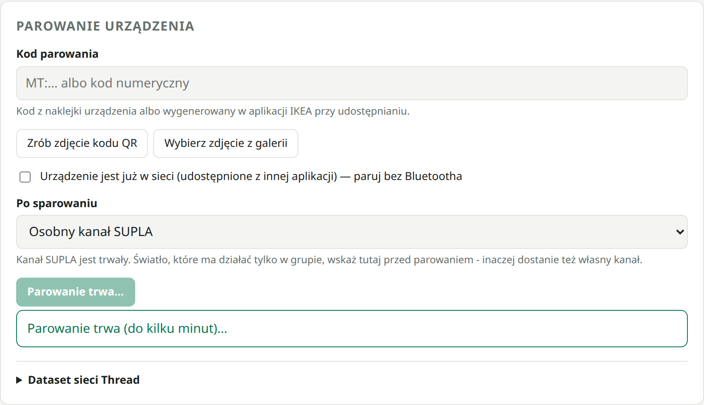

### Kopie zapasowe

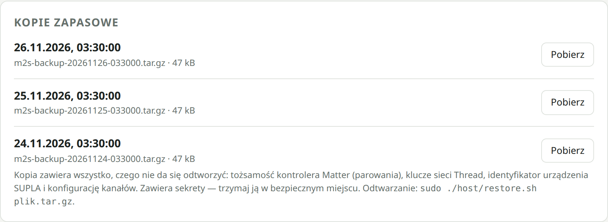

## Konwencje w tej dokumentacji

- Polecenia uruchamia się w katalogu projektu na hoście (tam, gdzie leży `docker-compose.yml`), o ile nie napisano inaczej.
- `<adres-rpi>`, `<hasło>`, `svrXX.supla.org`, `<VMID>` itp. to symbole zastępcze - wstaw własne wartości.
- Przy krokach zaznaczono, czy były **uruchomione na sprzęcie** (i na jakim), czy są **nieuruchamiane** / **niesprawdzone**.
