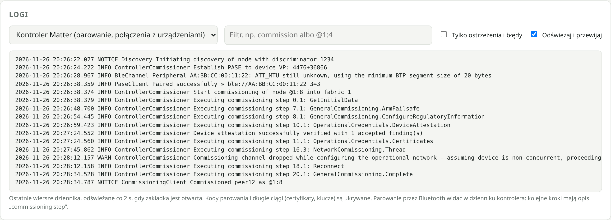
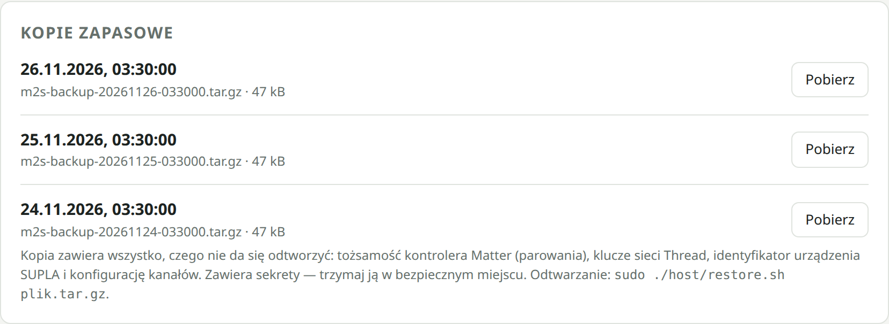

# Panel WWW

Panel jest częścią łącznika (`bridge`). Służy do wpisania konta SUPLA, parowania urządzeń, podglądu i testowania kanałów, pobierania diagnostyki i kopii zapasowych. Odświeża się sam co 2 sekundy.

Sprawdzone na Raspberry Pi: dostęp z LAN z logowaniem, zapis konta SUPLA, parowanie kodem i zdjęciem QR z telefonu, sterowanie gniazdkiem, pobieranie kopii.


*Zrzuty ekranu w tym dokumencie pokazują panel na przykładowych danych (skrypt `docs/img/make_screenshots.py`), nie prawdziwą instalację.* Na telefonie panel układa się w jedną kolumnę: [zrzut](img/panel-telefon.png).

## Dostęp

### Domyślnie: tylko lokalnie

Panel nasłuchuje na `127.0.0.1:8099`, bez hasła. Z innego komputera otwórz go przez tunel SSH:

```bash
ssh -L 8099:127.0.0.1:8099 <użytkownik>@<adres-rpi>
```

i wejdź na `http://localhost:8099`.

### Z sieci LAN - z hasłem

Potrzebne m.in. po to, żeby zrobić zdjęcie kodu QR telefonem.

1. W `.env` ustaw hasło:

   ```bash
   M2S_WEB_PASSWORD=<hasło>
   ```

2. W `config/devices.yaml` ustaw adres, na którym panel ma nasłuchiwać (adres hosta w LAN):

   ```yaml
   web:
     enabled: true
     host: <adres-rpi>
     port: 8099
   ```

3. Uruchom łącznik ponownie:

   ```bash
   docker compose up -d --force-recreate bridge
   ```

Panel będzie pod `http://<adres-rpi>:8099`. Jeśli `web.host` jest inny niż `127.0.0.1`, a hasła nie ma, łącznik **nie wystartuje** (komunikat w `docker compose logs bridge`).

> **Uwaga:** połączenie nie jest szyfrowane (HTTP). Hasło, kody parowania i pobierane kopie zapasowe idą przez sieć jawnym tekstem. Używaj panelu tylko w zaufanej sieci LAN i nie wystawiaj portu 8099 do Internetu.

Plik `config/devices.yaml` jest także zapisywany przez łącznik (przy dopisywaniu kanałów), a ręcznie dodane komentarze nie przetrwają. Żeby zmiana nie została nadpisana, edytuj go przy zatrzymanym łączniku (`docker compose stop bridge`).

### Logowanie


- Formularz z samym hasłem; sesja trzymana w ciasteczku przez 180 dni i przedłużana przy każdym wejściu do panelu. Restart łącznika ani hosta nie wylogowuje: sesje są zapisane w `config/web-sessions.json` (same skróty, bez tokenów). Zmiana hasła panelu unieważnia wszystkie sesje. Sprawdzone na Raspberry Pi: po restarcie łącznika zalogowana przeglądarka nie musi podawać hasła ponownie. Przycisk „Wyloguj” jest w nagłówku.
- Dla skryptów działa też nagłówek HTTP Basic (nazwa użytkownika dowolna):

  ```bash
  curl -u m2s:<hasło> http://<adres-rpi>:8099/api/state
  ```

- Panel można wyłączyć: `web.enabled: false`.

## Nagłówek i komunikaty

Pod nagłówkiem są zakładki: **Kanały** (kanały SUPLA i urządzenia bez kanału), **Grupy świateł**, **Parowanie**, **System** (konto SUPLA, kopie zapasowe) i **Logi**. Wybrana zakładka jest zapisana w adresie strony (np. `#grupy`), więc odświeżenie jej nie zmienia. Gdy adres nie wskazuje zakładki, panel wybiera ją sam przy otwarciu: bez wpisanego konta SUPLA - „System” (tam jest formularz konta), z kontem na telefonie (ekran dotykowy, wąskie okno) - „Parowanie”, a na komputerze - „Kanały”. Dopóki konta nie ma, zakładka „Parowanie” pokazuje żółtą informację, że kanały pojawią się w SUPLA dopiero po jego wpisaniu. Liczba przy zakładce „Kanały” to liczba kanałów, a dopisek `+N` oznacza urządzenia czekające bez kanału.

Znaczniki „MQTT” i „Matter · wersja” pokazują połączenie łącznika z brokerem i kontrolerem. Żółty komunikat u góry informuje o problemie z konfiguracją SUPLA (np. brak konta albo konflikt kanałów).

W stopce widać wersję łącznika - nazwa z wersją jest odnośnikiem do repozytorium na GitHubie, a skrót rewizji w nawiasie do konkretnego commita. Gdy na GitHubie jest nowsze wydanie, u góry pojawia się komunikat „Dostępna wersja X” z odnośnikiem do opisu wydania; panel niczego sam nie aktualizuje - robi się to poleceniem `sudo ./host/update.sh` na hoście. Sprawdzanie można wyłączyć (`update_check: false`); szczegóły: [aktualizacja.md](aktualizacja.md).

## Konto SUPLA


Wpisz **serwer** (np. `svrXX.supla.org`, bez `https://` i portu - adres widać w SUPLA Cloud i w aplikacji, w ustawieniach konta) oraz **e-mail konta**, potem „Zapisz konto”.

- Przed pierwszym połączeniem włącz w SUPLA Cloud dodawanie urządzeń (cloud.supla.org → „Moja SUPLA” → rejestracja urządzeń).
- Dane trafiają do `config/supla/account.json` (uprawnienia 600, poza repozytorium) i mają pierwszeństwo przed `SUPLA_SERVER` / `SUPLA_MAIL` z `.env`.
- Po zapisie `supla-device` uruchamia się ponownie z nowymi danymi. Konfiguracja SUPLA powstaje dopiero, gdy istnieje co najmniej jeden kanał.
- Po pierwszym połączeniu w SUPLA Cloud pojawi się urządzenie **„Matter2Supla”**. Funkcję kanału (np. „włącznik zasilania”) ustawia się w Cloud.

## Parowanie urządzenia


Formularz przyjmuje kod `MT:…` albo kod numeryczny. Kod można wpisać, albo odczytać ze zdjęcia: „Zrób zdjęcie kodu QR” (aparat telefonu) / „Wybierz zdjęcie z galerii”. Zdjęcie jest dekodowane lokalnie w łączniku i nigdzie nie jest zapisywane; limit rozmiaru to 12 MB (przeglądarka zmniejsza zdjęcie przed wysłaniem).

Pole wyboru „Urządzenie jest już w sieci…” przełącza na parowanie bez Bluetootha. Jeśli kontroler nie ma Bluetootha, panel zaznacza je sam i wyświetla o tym informację.

Lista „Po sparowaniu” decyduje, co stanie się z nowym urządzeniem:

- **Osobny kanał SUPLA** (domyślnie) - urządzenie dostaje własny kanał, jak dotąd;
- **Do grupy: …** - światło trafia do wybranej [grupy świateł](#grupy-świateł) i nie dostaje własnego kanału;
- **Bez kanału SUPLA** - urządzenie jest tylko sparowane; kanał można dodać później przyciskiem „Dodaj kanał”.

Wybór ma znaczenie, bo kanał SUPLA jest trwały: światło sparowane z domyślnym ustawieniem dostaje własny kanał od razu. Do grupy można je dodać także później, ale kanał już zostanie.

W rozwijanej części „Dataset sieci Thread” widać, czy kontroler ma zapisany dataset, i można go wkleić (wynik `docker exec otbr ot-ctl dataset active -x`).

Przebieg parowania, tryb parowania urządzeń i typowe niepowodzenia: [parowanie.md](parowanie.md).

## Kanały SUPLA


Na komputerze lista ma układ kolumn (kanał, nazwa i stan, informacje, przyciski) i zajmuje szerszą część okna; na telefonie te same dane układają się jedno pod drugim. Kliknięcie nazwy rozwija szczegóły. Lista urządzeń w zwartych wierszach: numer kanału, nazwa, stan (włączone / wyłączone / pomiar / niedostępne) i najważniejsza wartość - jasność światła, pomiary licznika, liczba świateł grupy. Przy urządzeniu niedostępnym widać, kiedy ostatnio dało znak życia.

- **Przełącznik** - włącza i wyłącza urządzenie (dla grupy: wszystkie jej światła). Komenda idzie prosto do urządzenia; przełącznik i stan na liście pokazują to, co potwierdziło urządzenie.
- **Znajdź** - urządzenie daje o sobie znać przez 15 s (żarówka pulsuje, gniazdko miga diodą); dla grupy robią to wszystkie jej światła. Przydaje się, gdy trzeba ustalić, która żarówka jest którym węzłem.
- **Po powrocie zasilania** (w szczegółach urządzenia) - co robi gniazdko lub żarówka po zaniku i powrocie prądu: „ostatni stan” (domyślnie w gniazdku IKEA), „zawsze włączone” (domyślnie w żarówkach KAJPLATS) albo „zawsze wyłączone”. Ustawienie zapisuje się w samym urządzeniu (atrybut Matter `StartUpOnOff`), nie w SUPLA; dla grupy dotyczy wszystkich jej świateł. Nie sprawdzone na sprzęcie.
- **Przejdź do SUPLA** - otwiera w nowej karcie ten kanał w SUPLA Cloud. Przycisk pojawia się po wpisaniu numeru kanału z Cloud: w szczegółach kanału „Ustaw odnośnik do SUPLA” przyjmuje numer albo wklejony adres (`https://cloud.supla.org/channels/12345`) i na życzenie uzupełnia pozostałe kanały kolejnymi numerami. Numeru kanału w Cloud urządzenie samo nie zna; po zmianie konta lub serwera odnośniki są kasowane.
- **Szczegóły** - rozwija wiersz: suwaki jasności i bieli, rodzaj urządzenia, producent, model, wersja firmware, węzeł i endpoint Matter, kanał SUPLA, grupy, do których światło należy, oraz przyciski „Zmień nazwę” i „Diagnostyka” (patrz niżej).
- **Zmień nazwę** - nazwa lokalna, widoczna w panelu; nie jest wysyłana do SUPLA Cloud i jej zmiana niczego w SUPLA nie rusza. Kanał dostaje ją w SUPLA tylko przy pierwszej rejestracji, czyli także po zmianie konta lub serwera - dzięki temu urządzenia od razu nazywają się tam tak jak w panelu. Nazwać można też urządzenie bez kanału (światło należące tylko do grupy, urządzenie nieobsługiwane); gdy dostanie kanał, nazwa przejdzie na ten kanał.

Pod urządzeniem, z wcięciem, stoją kanały i urządzenia od niego zależne: licznik energii pod swoim gniazdkiem, a pod grupą wszystkie jej światła (także te bez własnego kanału - można nimi sterować pojedynczo, a w szczegółach dodać im osobny kanał).

Gdy kanałów jest więcej, nad listą pojawia się pole „Szukaj”: zawęża ją po nazwie, modelu, numerze węzła lub kanału i stanie (np. `niedostępne`).

Nowo sparowane urządzenie obsługiwanego typu pojawia się tu **samo** jako kolejny kanał, a `supla-device` restartuje się z nową konfiguracją. Automat można wyłączyć (`auto_add: false` w `config/devices.yaml`) - wtedy kanał dodaje się przyciskiem „Dodaj kanał” na liście urządzeń bez kanału.

> **Kanału nie da się usunąć ani zmienić jego typu** bez usunięcia całego urządzenia z SUPLA Cloud razem z historią. Wyjaśnienie: [jak-to-dziala.md](jak-to-dziala.md#trwałość-kanałów-supla).

## Grupy świateł


Grupa to **jeden kanał SUPLA** (ściemniacz z regulacją bieli) sterujący kilkoma światłami naraz. Pojedyncze światła nadal działają jako osobne kanały - oba sposoby można mieszać, a jedno światło może mieć własny kanał i jednocześnie należeć do grupy.

- **Utwórz grupę** - tworzy pustą grupę, jeszcze bez kanału SUPLA. Trwały kanał powstaje dopiero po dodaniu pierwszego światła (zaznaczeniem w składzie albo parowaniem z wyborem „Do grupy”), więc grupa utworzona na próbę niczego w SUPLA nie zajmuje. Raz nadany kanał zostaje, także gdy grupa znów będzie pusta.
- **Skład** - po rozwinięciu grupy zaznacza się światła i zapisuje przyciskiem „Zapisz skład”. Skład można zmieniać dowolnie; numer kanału się nie zmienia.
- Światło wyjęte z grupy nie dostaje kanału samo - trafia na listę urządzeń bez kanału.

Grupa jest jednorodna: należą do niej tylko światła tego samego rodzaju. Dziś jedyny obsługiwany rodzaj to światło z regulacją jasności i bieli, więc tylko takie są na liście; gniazdka ani innego urządzenia dodać się nie da.

Zachowanie grupy:

- polecenie z SUPLA albo z panelu trafia do wszystkich dostępnych świateł grupy;
- grupa jest „włączona”, gdy świeci którekolwiek światło; jasność i biel pokazywane są z pierwszego świecącego;
- grupa jest „niedostępna” dopiero wtedy, gdy nie odpowiada żadne światło.

Grupa z jednym światłem też ma sens: po wymianie żarówki podmienia się skład grupy, a kanał SUPLA z nazwą, harmonogramami i historią zostaje. Żarówka z własnym kanałem po wymianie zostawia martwy kanał, którego nie da się usunąć.

## Urządzenia Matter bez kanału


Sekcja pojawia się, gdy sparowane są urządzenia, które nie mają kanału SUPLA:

- kilka czujników na jednym endpoincie (ALPSTUGA: temperatura i wilgotność, CO2, PM2.5): przy ręcznym dodawaniu przycisk dodaje ten kanał, na którym go naciśnięto, ale zdejmuje też blokadę „bez kanału” z całego endpointu, więc pozostałe czujniki dopiszą się wtedy same;
- typy jeszcze nieobsługiwane (np. czujniki ruchu i kontaktu) - można je sparować i pobrać diagnostykę, na podstawie której dopisuje się obsługę;
- światła z regulacją bieli przy `lights_as_channels: false` - bez kanału SUPLA, ale z przyciskami włącz/wyłącz oraz suwakami jasności i bieli. Domyślnie takie światło dostaje kanał „ściemniacz CCT” i te same suwaki są w sekcji kanałów. Światło kolorowe (KAJPLATS CWS) dostaje kanał „ściemniacz CCT + RGB”, a w szczegółach ma dodatkowo wybór koloru; wybór koloru przełącza żarówkę na tryb koloru, suwak bieli z powrotem na biel. Światła kolorowe nie należą do grup. Żarówka kolorowa sparowana przed tą funkcją jest rozpoznawana jako światło z regulacją bieli bez kanału; po aktualizacji łącznika zmienia rodzaj na „światło kolorowe” i kanał można jej dodać przyciskiem „Dodaj kanał”.

- urządzenia sparowane z wyborem „Bez kanału SUPLA” - mają przycisk „Dodaj kanał”, a światła także suwaki w szczegółach.

Światła należące do grupy nie są tu powtarzane - stoją pod swoją grupą w sekcji kanałów.

Kanał dla typu nieobsługiwanego powstaje dopiero po dodaniu obsługi danego typu, właśnie dlatego, że później nie da się go zmienić.

## Zrzut diagnostyczny

Przycisk „Diagnostyka” pobiera plik `matter-node-<id>.json` z atrybutami węzła i listą klastrów na endpointach. To samo z wiersza poleceń:

```bash
docker compose run --rm bridge diagnostics <node_id> > node.json
```

Domyślnie ze zrzutu usuwane są: numer seryjny, identyfikator egzemplarza, etykieta i lokalizacja oraz klastry z danymi sieci i poświadczeniami. Pełny zrzut (`--full` w CLI albo `?full=1` w adresie `/api/nodes/<id>/diagnostics`) zawiera te dane - **nie publikuj go**.

Format pasuje do komendy `import_test_node` kontrolera, więc zrzut można wczytać jako węzeł testowy ([rozwoj.md](rozwoj.md)).

## Logi



Zakładka pokazuje koniec dziennika, odświeżany co 2 s, gdy jest otwarta:

- **Kontroler Matter** - tu widać parowanie krok po kroku (wiersze „commissioning step”), próby połączenia Bluetooth i utratę łączności z urządzeniami;
- **Łącznik** - kanały, komendy, zapisy konfiguracji, start i wynik parowania.

Pole „Filtr” zostawia wiersze zawierające wpisany tekst (np. `commission` albo `@1:4` dla węzła 4), a „Tylko ostrzeżenia i błędy” ukrywa resztę. Odznaczenie „Odświeżaj i przewijaj” zatrzymuje widok, żeby dało się go spokojnie przeczytać. Kody parowania i długie ciągi szesnastkowe (certyfikaty, klucze) są w panelu ukrywane.

Dziennik kontrolera jest zapisywany do `data/matter/logs/` (rotacja dobowa, 7 plików) i nie trafia do kopii zapasowych. Po aktualizacji ze starszej wersji pojawi się dopiero po ponownym utworzeniu kontenerów (`docker compose up -d`), co robi też `host/update.sh`.

## Kopie zapasowe



Przycisk „Zrób kopię teraz” zleca kopię ręczną: na kilkanaście sekund zatrzymuje się kontroler Matter i połączenie z SUPLA, potem kopia pojawia się na liście. Kopie ręczne są tymczasowe - zostają najwyżej trzy i każda usuwa się sama po 3 dniach; przy każdej widać, kiedy zniknie. Wymaga jednostek systemd na hoście ([kopie-zapasowe.md](kopie-zapasowe.md#kopia-ręczna-z-panelu)).

Niżej lista kopii (ręcznych i z harmonogramu) z przyciskiem „Pobierz”. Kopie **zawierają sekrety**, a panel nie szyfruje połączenia - pobieraj je tylko w zaufanej sieci. Szczegóły: [kopie-zapasowe.md](kopie-zapasowe.md).
