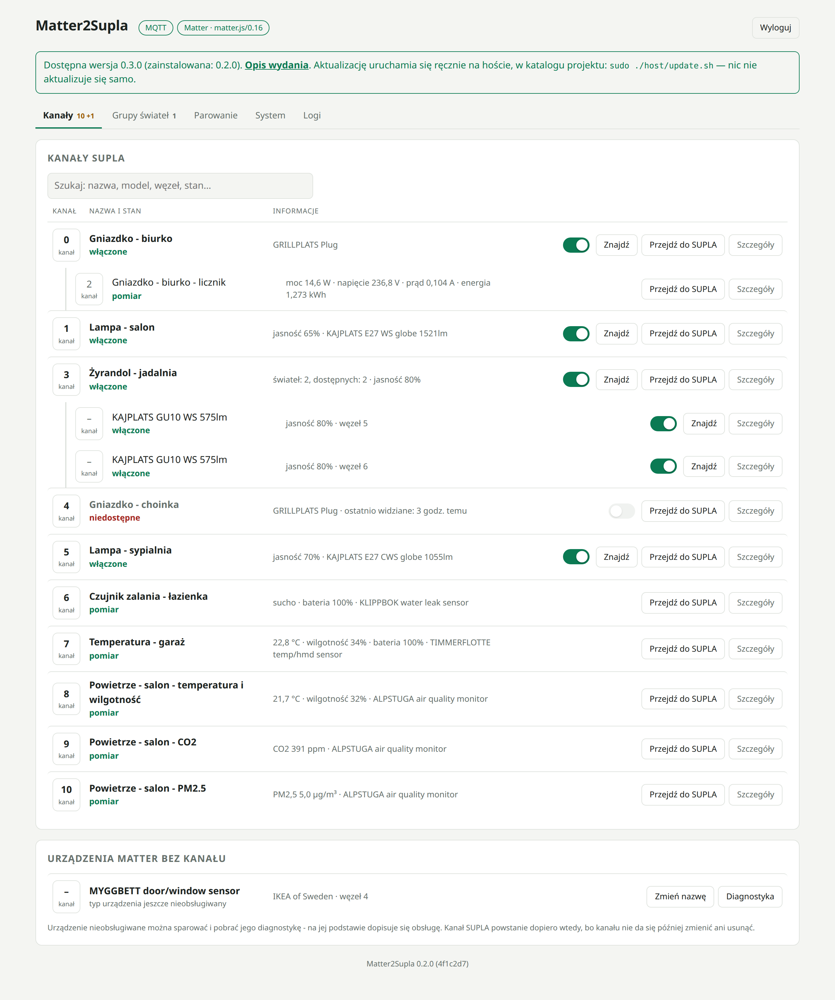
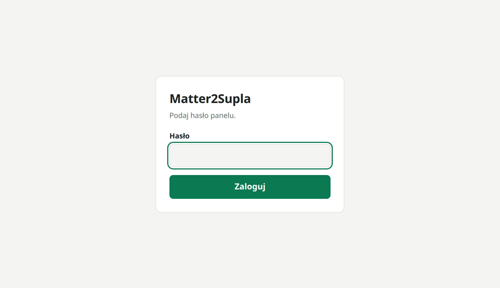
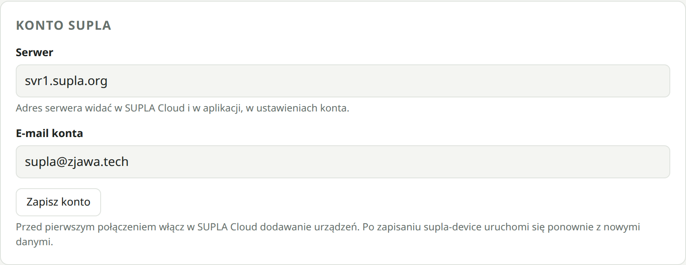
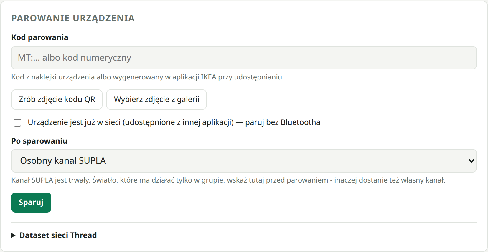
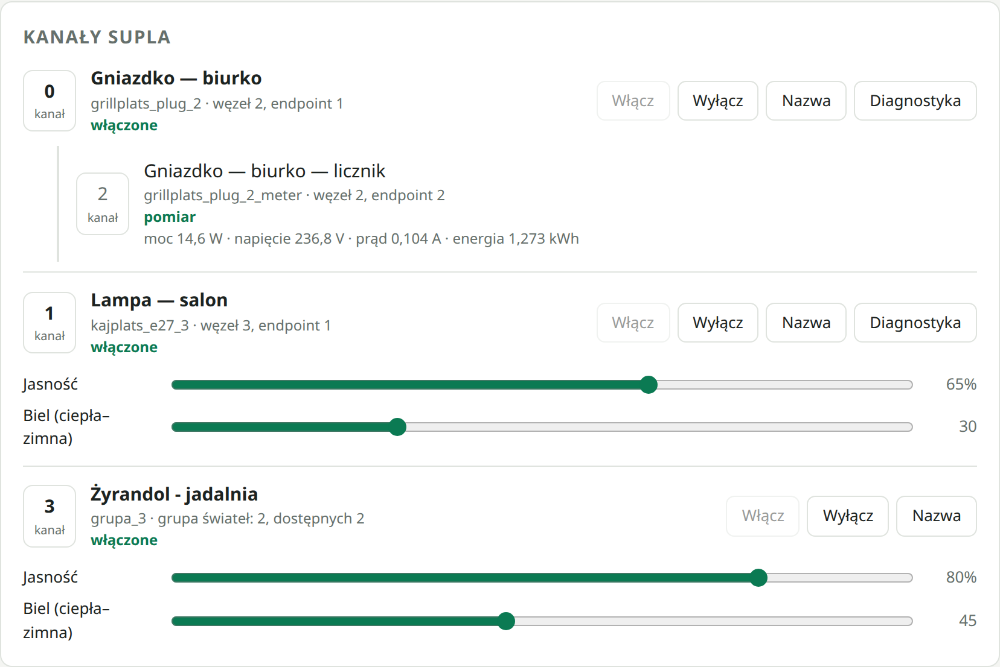
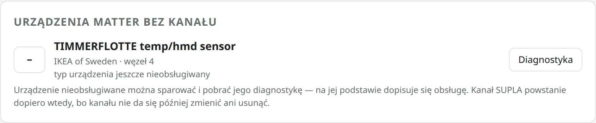

# Panel WWW

Panel jest częścią łącznika (`bridge`). Służy do wpisania konta SUPLA, parowania urządzeń, podglądu i testowania kanałów, pobierania diagnostyki i kopii zapasowych. Odświeża się sam co 2 sekundy.

Sprawdzone na Raspberry Pi: dostęp z LAN z logowaniem, zapis konta SUPLA, parowanie kodem i zdjęciem QR z telefonu, sterowanie gniazdkiem, pobieranie kopii.



*Zrzuty ekranu w tym dokumencie pokazują panel na przykładowych danych (skrypt `docs/img/make_screenshots.py`), nie prawdziwą instalację.* Na telefonie panel układa się w jedną kolumnę: [zrzut](img/panel-telefon.png).

## Dostęp

### Domyślnie: tylko lokalnie

Panel nasłuchuje na `127.0.0.1:8099`, bez hasła. Z innego komputera otwórz go przez tunel SSH:

```bash
ssh -L 8099:127.0.0.1:8099 <użytkownik>@<adres-rpi>
```

i wejdź na `http://localhost:8099`.

### Z sieci LAN - z hasłem

Potrzebne m.in. po to, żeby zrobić zdjęcie kodu QR telefonem.

1. W `.env` ustaw hasło:

   ```bash
   M2S_WEB_PASSWORD=<hasło>
   ```

2. W `config/devices.yaml` ustaw adres, na którym panel ma nasłuchiwać (adres hosta w LAN):

   ```yaml
   web:
     enabled: true
     host: <adres-rpi>
     port: 8099
   ```

3. Uruchom łącznik ponownie:

   ```bash
   docker compose up -d --force-recreate bridge
   ```

Panel będzie pod `http://<adres-rpi>:8099`. Jeśli `web.host` jest inny niż `127.0.0.1`, a hasła nie ma, łącznik **nie wystartuje** (komunikat w `docker compose logs bridge`).

> **Uwaga:** połączenie nie jest szyfrowane (HTTP). Hasło, kody parowania i pobierane kopie zapasowe idą przez sieć jawnym tekstem. Używaj panelu tylko w zaufanej sieci LAN i nie wystawiaj portu 8099 do Internetu.

Plik `config/devices.yaml` jest także zapisywany przez łącznik (przy dopisywaniu kanałów), a ręcznie dodane komentarze nie przetrwają. Żeby zmiana nie została nadpisana, edytuj go przy zatrzymanym łączniku (`docker compose stop bridge`).

### Logowanie



- Formularz z samym hasłem; sesja trzymana w ciasteczku przez 180 dni i przedłużana przy każdym wejściu do panelu. Restart łącznika ani hosta nie wylogowuje: sesje są zapisane w `config/web-sessions.json` (same skróty, bez tokenów). Zmiana hasła panelu unieważnia wszystkie sesje. Przycisk „Wyloguj” jest w nagłówku.
- Dla skryptów działa też nagłówek HTTP Basic (nazwa użytkownika dowolna):

  ```bash
  curl -u m2s:<hasło> http://<adres-rpi>:8099/api/state
  ```

- Panel można wyłączyć: `web.enabled: false`.

## Nagłówek i komunikaty

Znaczniki „MQTT” i „Matter · wersja” pokazują połączenie łącznika z brokerem i kontrolerem. Żółty komunikat u góry informuje o problemie z konfiguracją SUPLA (np. brak konta albo konflikt kanałów).

W stopce widać wersję łącznika. Gdy na GitHubie jest nowsze wydanie, u góry pojawia się komunikat „Dostępna wersja X” z odnośnikiem do opisu wydania; panel niczego sam nie aktualizuje - robi się to poleceniem `sudo ./host/update.sh` na hoście. Sprawdzanie można wyłączyć (`update_check: false`); szczegóły: [aktualizacja.md](aktualizacja.md).

## Konto SUPLA



Wpisz **serwer** (np. `svrXX.supla.org`, bez `https://` i portu - adres widać w SUPLA Cloud i w aplikacji, w ustawieniach konta) oraz **e-mail konta**, potem „Zapisz konto”.

- Przed pierwszym połączeniem włącz w SUPLA Cloud dodawanie urządzeń (cloud.supla.org → „Moja SUPLA” → rejestracja urządzeń).
- Dane trafiają do `config/supla/account.json` (uprawnienia 600, poza repozytorium) i mają pierwszeństwo przed `SUPLA_SERVER` / `SUPLA_MAIL` z `.env`.
- Po zapisie `supla-device` uruchamia się ponownie z nowymi danymi. Konfiguracja SUPLA powstaje dopiero, gdy istnieje co najmniej jeden kanał.
- Po pierwszym połączeniu w SUPLA Cloud pojawi się urządzenie **„Matter2Supla”**. Funkcję kanału (np. „włącznik zasilania”) ustawia się w Cloud.

## Parowanie urządzenia



Formularz przyjmuje kod `MT:…` albo kod numeryczny. Kod można wpisać, albo odczytać ze zdjęcia: „Zrób zdjęcie kodu QR” (aparat telefonu) / „Wybierz zdjęcie z galerii”. Zdjęcie jest dekodowane lokalnie w łączniku i nigdzie nie jest zapisywane; limit rozmiaru to 12 MB (przeglądarka zmniejsza zdjęcie przed wysłaniem).

Pole wyboru „Urządzenie jest już w sieci…” przełącza na parowanie bez Bluetootha. Jeśli kontroler nie ma Bluetootha, panel zaznacza je sam i wyświetla o tym informację.

W rozwijanej części „Dataset sieci Thread” widać, czy kontroler ma zapisany dataset, i można go wkleić (wynik `docker exec otbr ot-ctl dataset active -x`).

Przebieg parowania, tryb parowania urządzeń i typowe niepowodzenia: [parowanie.md](parowanie.md).

## Kanały SUPLA



Lista urządzeń, które mają kanał: numer kanału, nazwa, węzeł i endpoint Matter, stan (włączone / wyłączone / niedostępne).

- **Włącz / Wyłącz** - komenda idzie prosto do urządzenia; stan na liście zmienia się dopiero po potwierdzeniu z urządzenia.
- **Nazwa** - podpis kanału. SUPLA przyjmuje go tylko przy pierwszej rejestracji kanału; późniejsza zmiana w panelu nie zmieni nazwy w Cloud.
- **Diagnostyka** - zrzut atrybutów węzła (patrz niżej).

Nowo sparowane urządzenie obsługiwanego typu pojawia się tu **samo** jako kolejny kanał, a `supla-device` restartuje się z nową konfiguracją. Automat można wyłączyć (`auto_add: false` w `config/devices.yaml`) - wtedy kanał dodaje się przyciskiem „Dodaj kanał” na liście urządzeń bez kanału.

> **Kanału nie da się usunąć ani zmienić jego typu** bez usunięcia całego urządzenia z SUPLA Cloud razem z historią. Wyjaśnienie: [jak-to-dziala.md](jak-to-dziala.md#trwałość-kanałów-supla).

## Urządzenia Matter bez kanału



Sekcja pojawia się, gdy sparowane są urządzenia, które nie mają kanału SUPLA:

- typy jeszcze nieobsługiwane (np. czujniki) - można je sparować i pobrać diagnostykę, na podstawie której dopisuje się obsługę;
- światła z regulacją bieli przy `lights_as_channels: false` - bez kanału SUPLA, ale z przyciskami włącz/wyłącz oraz suwakami jasności i bieli. Domyślnie takie światło dostaje kanał „ściemniacz CCT” i te same suwaki są w sekcji kanałów.

Kanał powstaje dopiero po dodaniu obsługi danego typu, właśnie dlatego, że później nie da się go zmienić.

## Zrzut diagnostyczny

Przycisk „Diagnostyka” pobiera plik `matter-node-<id>.json` z atrybutami węzła i listą klastrów na endpointach. To samo z wiersza poleceń:

```bash
docker compose run --rm bridge diagnostics <node_id> > node.json
```

Domyślnie ze zrzutu usuwane są: numer seryjny, identyfikator egzemplarza, etykieta i lokalizacja oraz klastry z danymi sieci i poświadczeniami. Pełny zrzut (`--full` w CLI albo `?full=1` w adresie `/api/nodes/<id>/diagnostics`) zawiera te dane - **nie publikuj go**.

Format pasuje do komendy `import_test_node` kontrolera, więc zrzut można wczytać jako węzeł testowy ([rozwoj.md](rozwoj.md)).

## Kopie zapasowe


Lista kopii utworzonych przez `host/backup.sh` z przyciskiem „Pobierz”. Kopie **zawierają sekrety**, a panel nie szyfruje połączenia - pobieraj je tylko w zaufanej sieci. Szczegóły: [kopie-zapasowe.md](kopie-zapasowe.md).
