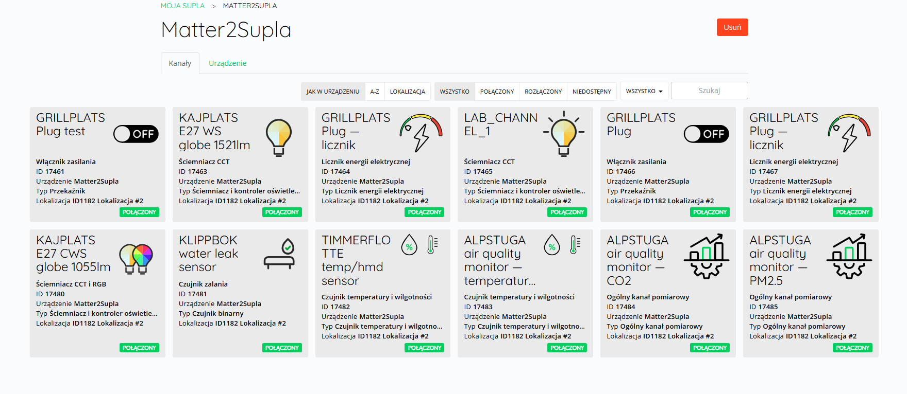
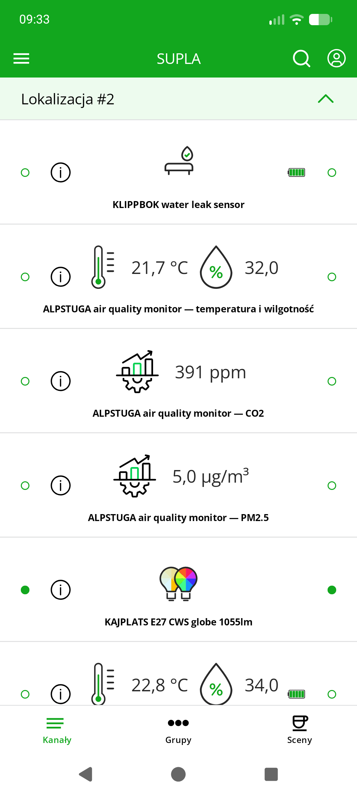
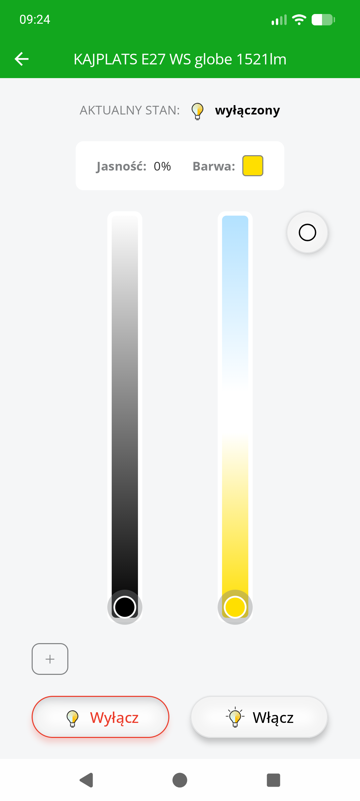
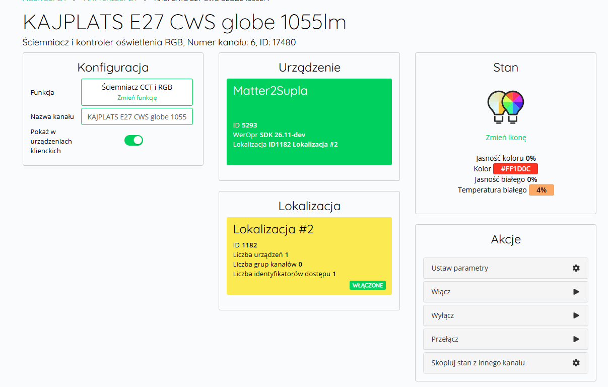
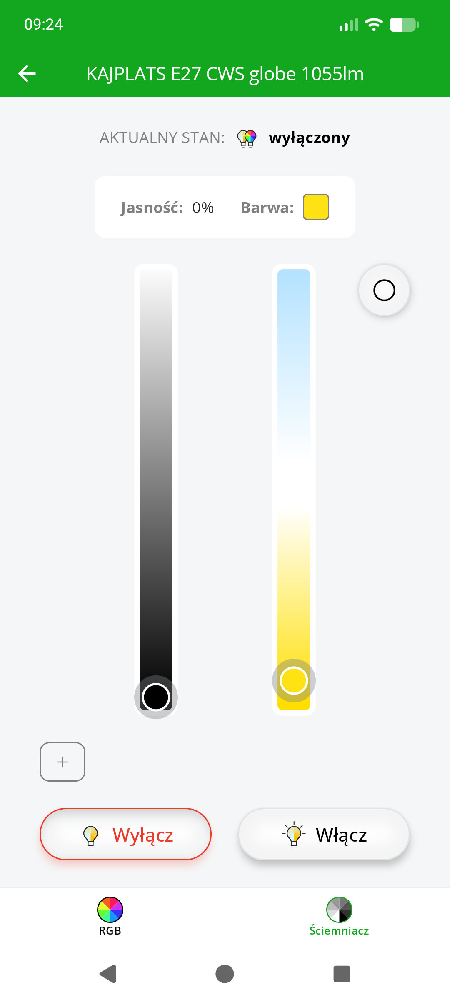
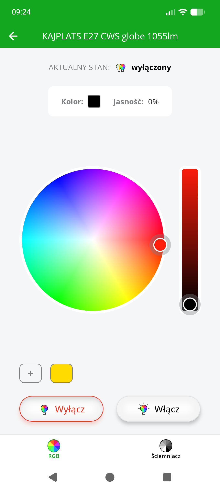
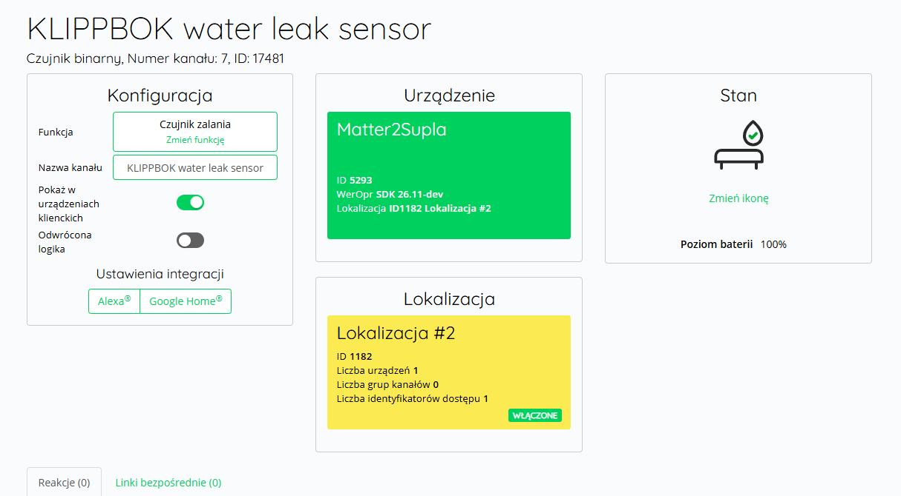

# Jak urządzenia wyglądają w SUPLA

Zrzuty z prawdziwej instalacji: konto testowe na SUPLA Cloud i aplikacja mobilna SUPLA (Android). Identyfikator urządzenia (GUID) na zrzutach z Cloud zamazano. Co jest sprawdzone na sprzęcie, a co nie - w [README](../README.md#stan-projektu).

Wszystkie kanały należą do jednego urządzenia SUPLA „Matter2Supla” (kolejne kanały to kolejne urządzenia Matter, patrz [jak-to-dziala.md](jak-to-dziala.md)). Funkcję kanału (np. „czujnik zalania”) ustawia się w SUPLA Cloud, nazwa kanału jest początkowa i można ją tam zmienić - nie wraca do panelu łącznika.

## Lista kanałów

W SUPLA Cloud (przeglądarka) - urządzenie „Matter2Supla” ze wszystkimi kanałami: gniazdka, liczniki energii, żarówki (WS i CWS), czujnik zalania, temperatura i wilgotność oraz trzy kanały monitora jakości powietrza:

W aplikacji mobilnej (lokalizacja z czujnikami i żarówką):

## Żarówka z regulacją bieli (KAJPLATS WS)

Kanał typu „ściemniacz CCT”: suwak jasności i suwak temperatury bieli (od zimnej do ciepłej).

## Żarówka kolorowa (KAJPLATS CWS)

Kanał typu „ściemniacz CCT i RGB” (`MatterRgbLight`). Żarówka świeci naraz tylko jednym trybem, bielą albo kolorem, więc w Cloud biel i kolor mają osobne wartości, ale tylko jedna z nich jest niezerowa.

W aplikacji są dwa widoki: „Ściemniacz” (jasność i biel) oraz „RGB” (koło kolorów i jasność koloru):

## Czujnik zalania (KLIPPBOK)

Kanał typu „czujnik binarny” z funkcją „czujnik zalania”; poziom baterii jest widoczny w stanie kanału. Przełącznik „Odwrócona logika” w Cloud zamienia znaczenie stanu, gdyby czujnik pokazywał zalanie odwrotnie.

## Czujniki środowiskowe

Temperatura i wilgotność (TIMMERFLOTTE, ALPSTUGA) są jednym kanałem „termometr i higrometr”, a CO2 i pył PM2.5 (ALPSTUGA) osobnymi kanałami „ogólny kanał pomiarowy” z jednostkami ppm i µg/m³ (widać je na liście kanałów w aplikacji powyżej).
